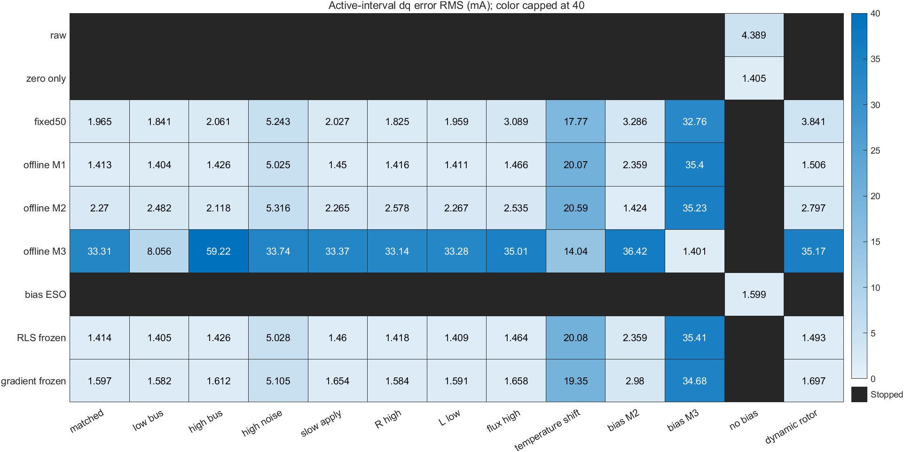

# PMSM两相采样偏移研究报告

日期：2026-11-01。固件基线：f2703e22cb4acde0b9caee0424f3e35aba2b7611。MATLAB R2024b实际执行，Simulink模型实际生成与运行；控制PI/SVPWM直接调用原始C核心。研究工作为本地未提交文件。本文结论不依赖板端运行、关闭保护或调整PI获得改善。

## 结论与解决方案

当前最值得优先核实的机制是**共用无缓冲REF分压对共模变化的耦合**。它有原理图和器件文档支持，且不拟合参数的简化计算预测约58.25mA/50%duty，与历史61.5mA读数量级接近。它尚不能单独解释PWM同步采样动态，因此不是已确诊根因。

推荐组合为：**核实并修正REF/采样链 → 可信零电流基线 → 对剩余偏移离线辨识并独立验证 → 有效域内固定参数补偿 → 有误差范围支持的反馈/保护接入**。若硬件修正消除主要偏移，则优先使用更简单的剩余误差校准。硬件条件不变时，O3软件补偿是有条件候选；不能把历史k直接作为20kHz认证参数。

在线RLS和ESO都有适用条件，但当前没有理由用它们替代独立标定。运行期间既没有可信真实电流参考，也缺少识别偏移所需的独立信息；算法自身反馈趋零不是补偿正确的证据。

## 事实、假设与冲突修正

已核对固件：20kHz PWM、1kHz电流环、12bit ADC、12MHz ADC时钟、采样7.5周期、转换12.5周期、U/V双ADC同时注入；原先材料中的14MHz并非本基线配置。名义ADC换算0.805664mA/count。

PI参数Kp=0.5V/A，Ki=150V/(A·s)，tracking=200/s；参考限幅40mA，12V下dq电压圆限幅0.4V。R=5.5Ω、Ld=0.7185mH、Lq=0.905mH、磁链0.00257Wb、极对数7仍为参考/候选参数，不是2208实测模型。机械惯量、阻尼与温度响应均为研究假设。

A1原理图显示两个INA199 REF共用10kΩ/10kΩ分压；它不能当成理想低阻1.65V。INA199A1典型信号带宽80kHz，不代表PWM共模恢复带宽。历史0/50/70%读数来自40kHz近似摘录；20kHz只有50%约60/59mA，完整原始流缺失，不混合拟合。

附件中的fault_flags=4、自举异常不直接当作已确认事实；本仓库故障枚举和DRV8313电荷泵结构已另行核对。默认DQ_VEC0固定900/900/900，不输出PI结果，所以诊断动作完成不等于闭环通过。

参数逐项来源见hardware_facts.md；假设见model_assumptions.md；原理图/器件依据及节点方程见ref_root_cause.md。

## Model A：数学关系与可辨识性

幅值不变Clarke矩阵为 `[[1,0],[1/sqrt(3),2/sqrt(3)]]`。两相各+61.5mA时得到alpha=61.5mA、beta=106.52mA、幅值123mA、角度60°，Park旋转不改变范数。7项独立检查通过，SLX与独立数值链的最大差约9.02e-17A。

采样模型显式包含20mΩ、增益50、固定偏移、PWM相关偏移、噪声、量化、延迟、饱和。仿真真值只用于生成与评价，不输入估计器或控制器。

在联合回归 `[1,du,dmean]` 中，等占空比设计秩2、固定duty秩1；同一电压矢量只加零序也秩2；独立改变矢量和零序的合成设计秩3、条件数约25.38。前两类无法同时识别独立相斜率和共同斜率。已知b0且真实电流独立已知时，一个非零duty可以估计单一k，但不证明线性普适或物理模型正确。

## O1/O2/O3与简单基线的比较

O3拟合M1每相duty、M2三相共同duty、M3共模/状态/边沿时间行为特征；训练1200点，选型400点，测试600点分离。95%参数区间只对应合成噪声假设。额外120组恢复常数与非线性失配中，47组通过验证筛选、73组被拒绝；本有限测试无“验证通过但独立测试超过3mA”，不能推广为绝对界。

O1实现RLS、梯度法、可信参考门控和激励检查。16组试验显示：联合b0/k在固定duty下不更新；有激励且真实参考可信时RLS可收敛；无门控RLS会吸收约40mA真实电流。另将可信标定阶段得到的参数冻结后接入同一FOC矩阵，与O3公平比较。这样O1与O3的运行架构趋同，区别主要在标定求解方式。

O2分别实现测量偏置扩张与真实电压扰动扩张，共120组带宽/噪声/动态对照。同时把电流、未知电压扰动和测量偏置均作为状态时，可观测矩阵秩2/3，存在 `[1,R,-1]` 不可观测方向。当前测量偏置ESO冷启动在有偏移时不能通过候选保护，不通过先运行不可信反馈来等待收敛。其他初始化、额外测量或设计可能改善，但不解决缺失信息本身。

统一闭环351组：13情形×9方法×3种子。下表为M1合成偏移场景的3种子平均dq**测量误差**，不是iq参考跟踪误差。完整表见comparison_summary.csv，提前停机不填零。

| 方法 | dq测量RMSE | 完成至期限 | 结果解读 |
|---|---:|---:|---|
| 不补偿/仅零偏 | 不可计算 | 0/3 | 候选保护在起点拒绝；不是零误差 |
| 固定50% | 1.96mA | 3/3 | 有7次假设误差界越界 |
| O3 M1 | 1.41mA | 3/3 | 本3组未观测到越界 |
| O3 M2 | 2.27mA | 3/3 | 模型不匹配，12次越界 |
| O3 M3 | 33.31mA | 3/3 | 错模型，747次越界 |
| 可信标定RLS后冻结 | 1.41mA | 3/3 | 本3组未观测到越界 |
| 可信标定梯度后冻结 | 1.60mA | 3/3 | 1次越界 |
| 当前测量偏置ESO | 不可计算 | 0/3 | 冷启动校准条件不满足 |

若真实合成来源改为M2或M3，各自匹配补偿约1.42/1.40mA；错误使用M1对M3可达35.40mA。M1通道各加10mA未建模温漂后，M1补偿dq误差约20.07mA。故不能按M1工况占多数的总体成功率给算法排通用名次。

| 方法 | 计算/移植代价 | 适应能力与限制 |
|---|---|---|
| 固定50% | 两次减法，最简单 | 只局部经验；duty/温度/母线变化无保证 |
| O3 M1/M2 | 每相线性式，少量乘加 | 有效域内固定；标定外不可自行适应 |
| O3 M3 | 多特征，可能含指数/查表 | 需真实可获得的母线/采样特征，当前固件缺母线ADC |
| RLS | 每相小矩阵递推O(n²)、协方差状态 | 可跟踪但必须有可信参考与激励，运行时冻结则同固定补偿 |
| 梯度 | O(n)更新与参数状态 | 更简单但步长/收敛与漂移权衡，本试验比RLS慢 |
| ESO | 固定小矩阵状态更新 | 依赖电机/电压模型和初始化；不能唯一分离两类未知扰动 |

未测STM32运行周期，不用主机计时推断中断开销。

## Model B：闭环、保护与稳定性

完整Simulink模型包含dq电机、逆变器平均值、ADC、实际C PI/SVPWM、CCR量化、1ms采样与775µs施加延迟。7组对照重跑通过；原保护+偏移首先触发原始W，匹配补偿+候选区间运行到250ms，dq测量误差1.474mA。能量恒等式最大误差2.78e-17W；C与独立公式对照最大差6.20e-8；当前调度器交叉差近数值零。

统一矩阵的合成M3选择250us高窗，非固件默认225us低窗；run_phase_features另按独立TIM1计数公式核对两窗并运行各自闭环。20个额外独立噪声种子的名义M1案例均运行到期限，dq误差均值约1.382mA、种子间标准差0.0587mA；这不是实物或全工况置信保证。

原固件runtime先检查U/V及W，再将数据送电流环。约60/59mA共同偏移推算W≈−119mA，大于128count≈103.125mA，因此单独在后级减偏移不能解除前级停止。

54组R/L/延迟局部线性分析均离散极点模小于1；名义−3dB带宽约4.2Hz。此结果只对未饱和局部电气模型有效。实际C的持续饱和试验9986拍限幅，峰值积分约0.439V，恢复电阻对象/零参考后退出饱和；不据此宣称所有失配全局稳定。

## Model C：开关与采样窗口

使用可检查的理想MOSFET/二极管状态方程，而非声称已经搭建Simscape器件网络。包括非重叠死区、U/V分流器与W无分流器、浮动中性点、80kHz信号通道、独立假设的共模沿瞬态、ADC孔径；转换完成时间单独记录。24组扫描满足KCL/无直通检查；电压平均检查差7.70mV，开环采样步长细化差0.491mA。

另在锁转子、等电感、无死区的共同物理子集比较闭环平均/开关模型。0.25µs粗步长曾不收敛，未放宽判据；25/12.5ns下40mA参考的周期平均差约2.413mA，细化差1.809mA。此处仍有离散开关/采样纹波误差，不能以Model B的1.4mA宣称全开关模型同精度。动态沿耦合与REF节点寄生未知，不能由合成瞬态确诊物理根因。

## “真实电流可推断到什么程度”

若采样时刻每相总模拟残差有可信界epsilon，ADC再加半LSB，则修正值c给出的真实U/V区间为 `[c−e,c+e]`，W区间半宽为eU+eV。由Clarke/Park可计算dq范数界；相等每相e时，最坏dq误差不超过2e。3mA模拟界加半LSB对应约6.806mA采样时刻dq范数界，**该3mA是测试假设，不是实测认证**。

边界只描述采样时刻；采样间真实电流变化须另由动态/快速保护覆盖。没有可信误差范围时，算法不能从一个带偏移测量唯一恢复真实电流。高斯噪声也无确定有限界，不能拿3σ当绝对保护保证。

候选区间保护在5万组有界合成验证中无界内漏放；便携C另5万组对照。两者只验证条件数学契约和实现，不验证实板是否满足契约。误差界未知、校准失效或越域时必须退出。

## 最终参数、有效范围与交付

最终研究参数完整记录在parameters.m及各MAT配置，合成拟合参数在fit_parameters.csv。可交付的实物参数只有已核对的配置/名义值；**20kHz ku/kv、REF动态、温度系数、真实电流误差界均TBD**。历史40kHz原点拟合约0.122905A/duty仅供现象对照。

软件候选适用域为经过独立校准且同版本/相位/供电/温度/占空比范围；本研究扫描30–70%duty、10–14V等范围只是测试范围，未把它认证为实物域。80–100%不外推。采样窗、保护、硬件或参考电路改变后须重新标定。

交付可运行A/B/C、三条算法研究与对照数据、研究候选C接口、Issue2电流内环SLX/函数、独立验证脚本及报告。硬件最小补证据见experiment_design.md；移植细节见stm32_integration.md；Issue2接口见issue2_interface.md。

当前研究能够给出有证据的解决路径及失败边界，不能声称实物闭环已修好或真实电流已实测准确。最终选型是上述条件组合，物理模型尚未唯一确定；新增实物信息应首先用于验证REF假说，而非盲目增加观测器复杂度。
